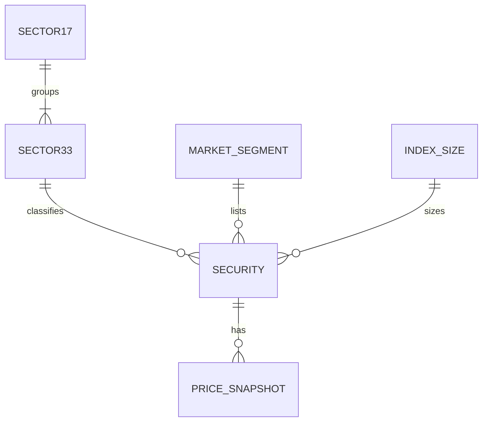

# Week 9 — Data model, querying and cleaning (Corte 2)

Individual graded activity · Data Science · dataset: Tokyo Stock Exchange listed securities (`stock_list.csv`).

## Contents

| Path | What it is |
|---|---|
| `cleaning_and_queries.ipynb` | Executed notebook: diagnosis → cleaning → before/after → SQLite load → 2 queries |
| `docs/erd.md` | ERD (Mermaid, renders on GitHub) with attributes and cardinalities |
| `sql/schema.sql` | DDL that implements the ERD |
| `data/raw/stock_list.csv` | Original file, untouched |
| `data/clean/stock_list_clean.csv` | Cleaned dataset (4,121 rows) |
| `data/clean/stock_list_dropped_no_price.csv` | The 296 rows removed (no market data) |
| `data/clean/before_after_report.csv` | Before/after metrics table |
| `data/clean/stock_market.db` | SQLite database built from the ERD |
| `docs/q1_top_sectors.png`, `docs/q2_segment_cap.png` | Charts for the two questions |

## ERD

Five lookup/entity tables around one fact-like table; full diagram and cardinalities in [`docs/erd.md`](docs/erd.md).



## Before / after cleaning

| Metric | Before | After |
|---|---:|---:|
| Rows | 4,417 | 4,121 |
| Columns | 16 | 17 (`instrument_type` added) |
| Null values (NaN) | 1,829 | 0 |
| `'-'` placeholders (disguised nulls) | 6,380 | 0 |
| Exact duplicate rows / duplicate codes | 0 / 0 | 0 / 0 |
| Distinct `17SectorName` labels | 34 (trailing-space variants) | 18 (17 sectors + `Not applicable (fund)`) |
| Date columns stored as real dates | 0 | 2 |
| Memory | 2,561 KB | 1,324 KB |

## Data & cleaning

The dataset is the official Tokyo Stock Exchange (JPX) list of 4,417 listed securities as of December 30, 2021, including companies, ETFs and REITs, with their market segment, industry sector, TOPIX size class, closing price, shares issued and market capitalization. I found three kinds of problems: 1,829 true missing values, 6,380 disguised nulls written as the text "-", and inconsistent text formats such as trailing spaces that split one sector into two labels (34 labels became 18 after normalization) and full-width parentheses. I replaced the "-" placeholders with real nulls, imputed categorical gaps with explicit labels ("Not applicable (fund)", "Unclassified", "Unassigned", "Not in TOPIX size index"), and removed 296 companies that had no closing price, because inventing a price would have produced false market capitalizations. I also converted the date columns from numbers to datetime, shares and capitalization to integers, the codes to text identifiers, and renamed all columns to snake_case; no exact duplicates or repeated codes were found, and four pairs of identical names turned out to be different companies, so they were kept. The first question asked which industry sectors hold the most market capitalization inside the Prime Market: Electric Appliances leads with about 132.7 trillion JPY (18.3%), and the top five sectors together hold 51.7% of the segment's value. The second question compared the typical company size across the Prime, Standard and Growth segments: the median Prime company is worth about 61.4 billion JPY versus 6.3 for Standard and 7.6 for Growth, and the Prime mean is 6.4 times its median, which shows that a handful of giant firms dominate the market.

## Queries and findings

**Q1 — Which sectors concentrate the most market cap in the Prime Market?** (filter: equities in Prime Market; aggregation: `SUM`/`COUNT` by sector, SQL with joins + pandas cross-check). Electric Appliances (140 companies, 132.65 T JPY, 18.3%), Information & Communication (75.68 T) and Transportation Equipment (67.52 T) lead; the top 5 hold 51.7% of the 726 T JPY total. The market is concentrated in manufacturing and technology.

**Q2 — How does typical company size differ across segments?** (filter: equities with a defined segment; aggregation: count, median, mean). Medians are 61.4 / 6.3 / 7.6 billion JPY for Prime / Standard / Growth. Growth firms are slightly larger than Standard ones at the median, and the mean-to-median ratio is far higher in Prime (6.4× vs 2.5×), so averages hide a very skewed distribution — use the median.

## How to reproduce

```bash
pip install pandas matplotlib jupyter
jupyter nbconvert --to notebook --execute --inplace cleaning_and_queries.ipynb
```

## Notes / assumptions

- Prime Market includes the single "Prime Market (Foreign Stock)" listing in Q2 (grouped by prefix); Q1 uses the exact `Prime Market` label (1,837 companies).
- One row has a fractional `IssuedShares`; it was rounded, so the `close × shares = market_cap` check uses a relative tolerance of 1e-6.
