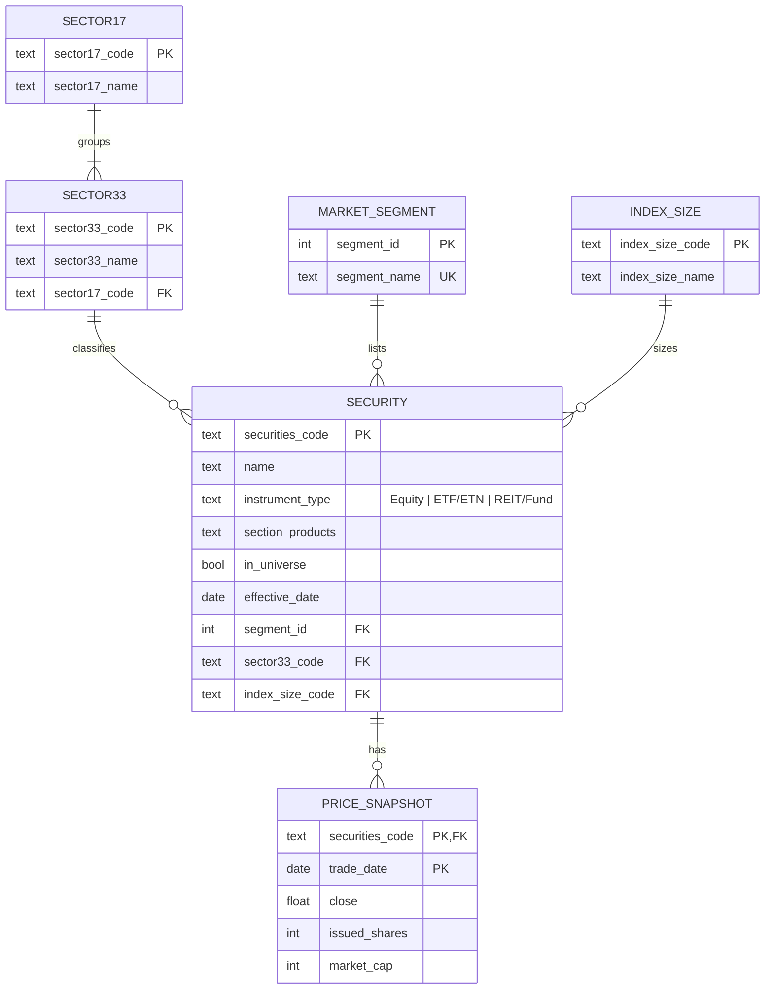

# ERD — Tokyo Stock Exchange listing

## Cardinalities

| Relationship | Cardinality | Meaning |
|---|---|---|
| SECTOR17 → SECTOR33 | 1 : N (mandatory both sides) | each of the 33 sectors belongs to exactly one of the 17 macro-sectors; a macro-sector has one or more sectors |
| SECTOR33 → SECURITY | 1 : N (a sector may have 0 securities) | a security has exactly one sector (placeholder `NA` / `UNC` for funds / unclassified) |
| MARKET_SEGMENT → SECURITY | 1 : N | a security belongs to exactly one segment (Prime, Standard, Growth, ...) |
| INDEX_SIZE → SECURITY | 1 : N | a security has one TOPIX size class (or `NA`) |
| SECURITY → PRICE_SNAPSHOT | 1 : N | one snapshot per trade date; this file has one date per security, but the key allows a time series |

**Design notes.** The flat CSV mixes four reference attributes (segment, 33-sector, 17-sector, size) with the security itself, repeating their names thousands of times. Normalizing them into lookup tables removes that redundancy (3NF). `sector17` is *not* stored in `SECURITY` because it is functionally dependent on `sector33` (verified in the notebook: each 33-sector maps to exactly one 17-sector). Prices live in their own table because they change with time while the security's descriptive data does not. DDL: `sql/schema.sql`.
