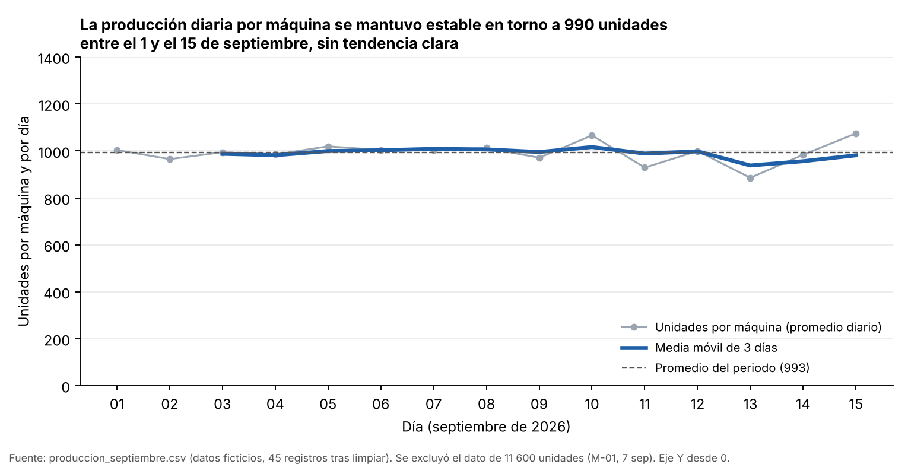
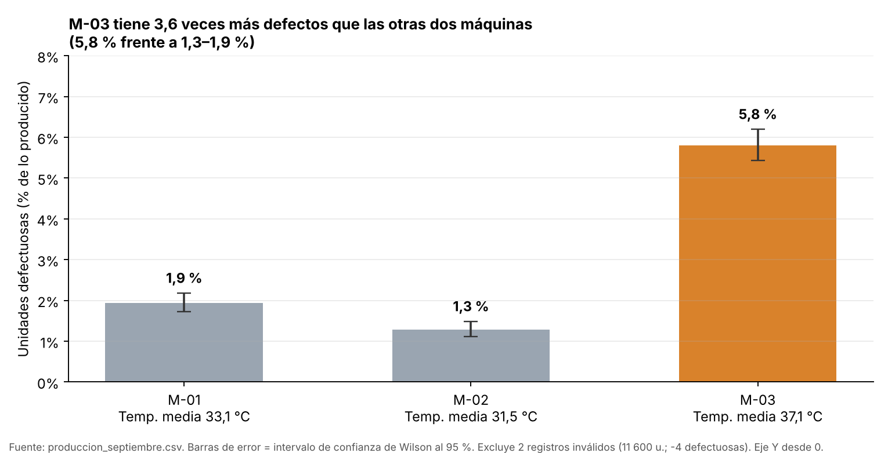

# Análisis temporal y visualización — Producción diaria de una planta de empaques

**Actividad calificable · Corte 3 · Semana 14** — Ciencia de Datos · Ingeniería Industrial · CORHUILA 2026-B

| | |
|---|---|
| **Estudiante** | Zara Melisa Monroy Vera |
| **GitHub** | `zara-mon2006` |
| **Serie analizada** | Unidades producidas por máquina y por día (promedio de las máquinas con dato válido) |
| **Dataset** | `data/produccion_septiembre.csv` — registro de producción de 3 máquinas (M-01, M-02, M-03) del 1 al 15 de septiembre de 2026, tomado del taller de la semana 8 (`08-week/02-optional-activity/TRABAJO CLASE/`). **Datos ficticios** |

> ### ¿Por qué esta serie y no la Bolsa de Tokio?
> El dataset principal de los Cortes 1 y 2 (listado JPX) es una **foto de un solo día** (30 de diciembre de 2021): no tiene serie temporal, como se anotó en los README de las semanas 7 y 10.
> El único archivo del repositorio con fechas y un indicador de producción es el del taller de la semana 8, así que el análisis se hace con él.
> **Limitación importante:** son solo **15 días** (45 registros). Sirve para aplicar el método completo, pero no alcanza para afirmar estacionalidad semanal ni tendencias de largo plazo; el informe lo señala donde corresponde.

## Contenido de la carpeta

| Archivo | Para qué sirve |
|---|---|
| `README.md` | Este informe: método, resultados, gráficos, SQL/DAX, *Findings* (EN) y referencias |
| `analisis_temporal.py` | Limpieza, resample, media móvil, tendencia, estacionalidad y los 2 gráficos |
| `consultas_sql.sql` | Consulta "antes" y "después" de la media móvil en SQL |
| `benchmark_sql.py` | Verifica que el SQL coincide con pandas y mide el tiempo |
| `data/produccion_septiembre.csv` | Datos crudos (47 filas) |
| `salidas/` | `produccion_limpia.csv`, `serie_diaria.csv`, `serie_semanal.csv`, `comparacion_por_maquina.csv`, `resumen_resultados.md`, `resultados_sql.md` |
| `img/` | `g1_evolucion_diaria.png`, `g2_comparacion_maquinas.png` |

---

## 0. Limpieza previa

Antes de agregar hubo que limpiar (reglas explícitas en el script; Wickham, 2014):

| Problema | Cantidad | Tratamiento |
|---|---|---|
| Nombres de máquina mal escritos (`m-02`, ` M-03`, `M01`, `m-03`) | 4 | Se normalizan a `M-01`, `M-02`, `M-03` |
| Filas duplicadas exactas | 2 | Se eliminan → quedan **45** filas (15 días × 3 máquinas) |
| `unidades_producidas = 11 600` (M-01, 7 sep; lo normal ronda 800–1 100) | 1 | Se deja **vacío**: no se corrige a ojo (podría ser 1 160, pero eso sería suponer) |
| `unidades_defectuosas = −4` (M-02, 10 sep) | 1 | Se deja vacío: es imposible |
| `temperatura_c` vacía | 2 | Se dejan vacíos (no se usa en la serie principal) |

Como el 7 de septiembre falta un dato de M-01, la serie principal es el **promedio por máquina** y no la suma de la planta: sumar subestimaría ese día.

## 1. Serie temporal: resample y media móvil

**Pregunta:** ¿cambia la producción diaria durante el periodo y hay un patrón que se repita?

**Método.** Con `fecha` como índice se agregó con `resample("D")` (promedio diario de unidades por máquina) y con `resample("W-SUN")` (semanas lunes–domingo).
Sobre la serie diaria se calculó una **media móvil de 3 días** (`rolling(3)`), que solo se reporta con 3 días completos. Se eligió 3 días porque con 15 observaciones una ventana semanal dejaría
solo 9 puntos; la media móvil suaviza el ruido de corto plazo para ver el nivel de fondo (Hyndman & Athanasopoulos, 2021).

```python
diario = s.resample("D").agg(unidades_por_maquina=("unidades_producidas", "mean"))
diario["media_movil_3d"] = diario["unidades_por_maquina"].rolling(3).mean()
semanal = s.resample("W-SUN").agg(unidades_por_maquina=("unidades_producidas", "mean"))
```

### Tendencia

| Medida | Valor |
|---|---|
| Promedio del periodo | **993 unidades por máquina y por día** |
| Variación diaria (desv. estándar) | 46,7 unidades (4,7 % del promedio) |
| Mínimo / máximo diario | 886 (13 sep) / 1 075 (15 sep) |
| Pendiente lineal | **−0,21 unidades/día** (IC 95 %: −6,5 a +6,0); R² = 0,000; p = 0,94 |
| Media móvil 3 d: máximo / mínimo | 1 017 (10 sep) / 938 (13 sep) |

| Semana (resample `W-SUN`) | Días con dato | Unidades por máquina y día |
|---|---|---|
| 1–6 sep | 6 (semana incompleta, empieza el martes) | 996 |
| 7–13 sep | 7 | 980 |
| 14–15 sep | 2 (semana incompleta) | 1 029 |

**Lectura.** **No hay tendencia**: la pendiente es prácticamente cero y su intervalo es simétrico alrededor de 0. La producción oscila poco (desviación estándar de 4,7 %; los extremos diarios están −11 % y +8 % del promedio) y la media móvil
se mantiene entre 938 y 1 017. Las semanas del resample son parecidas entre sí (996 y 980); la tercera solo tiene 2 días, por lo que su 1 029 no es comparable.

### Estacionalidad

| Prueba | Resultado | Conclusión |
|---|---|---|
| Promedio por día de la semana | Lun 994 · Mar 1 030 · Mié 968 · Jue 1 030 · Vie 957 · Sáb 1 010 · Dom 945 | Diferencias de hasta ~85 unidades (≈ 9 %) |
| Kruskal-Wallis entre días de la semana | p = 0,22 (solo 2 observaciones por día) | **No significativa** (Kruskal & Wallis, 1952) |
| Autocorrelación al rezago 7 (serie sin tendencia) | +0,27 con solo 8 pares | Sin valor estadístico (Box et al., 2015) |

**Lectura.** No se detecta estacionalidad semanal, pero **tampoco se puede descartar**: 15 días son apenas dos ciclos semanales y el domingo aparece como el día más bajo
(945; también el mínimo del periodo, el 13 de septiembre) sin que las pruebas puedan distinguirlo del azar. Como regla práctica, evaluar un patrón semanal con confianza requiere varias semanas de datos (aquí, 8–10 o más), no dos.

---

## 2. Dos visualizaciones

### Gráfico 1 — Evolución (línea)



**Por qué una línea:** el tiempo es continuo y lo que interesa es la forma de la trayectoria (Knaflic, 2015). Se muestran **el dato diario en gris, la media móvil de 3 días en azul y el promedio del
periodo como referencia punteada**. **Eje honesto:** el eje Y **empieza en 0**; así una variación de unos pocos puntos porcentuales se ve con su tamaño real y no se magnifica con un eje recortado (por ejemplo 880–1 080), que haría
parecer dramática una oscilación normal. **Título = conclusión:** "La producción diaria por máquina se mantuvo estable en torno a 990 unidades entre el 1 y el 15 de septiembre, sin tendencia clara".
El pie del gráfico avisa que se excluyó el dato de 11 600 unidades.

### Gráfico 2 — Comparación (barras)



**Por qué barras:** se comparan magnitudes entre categorías (3 máquinas) (Wilke, 2019). **Eje honesto:** el eje Y empieza en **0** (la longitud de la barra es proporcional al valor; Tufte, 2001), cada barra lleva su valor
y **barras de error con el intervalo de confianza de Wilson al 95 %** (Wilson, 1927). **Color con propósito:** naranja solo para la máquina que se aparta (M-03) y gris para las demás. **Título = conclusión:** "M-03 tiene 3,6 veces más
defectos que las otras dos máquinas (5,8 % frente a 1,3–1,9 %)". Bajo cada nombre se muestra la temperatura media de la máquina como contexto.

| Máquina | Unidades válidas | Defectuosas | % defectos (IC 95 %) | Temp. media | Unidades/día |
|---|---|---|---|---|---|
| M-01 | 13 980 | 271 | 1,9 % (1,7–2,2) | 33,1 °C | 999 |
| M-02 | 14 074 | 181 | 1,3 % (1,1–1,5) | 31,5 °C | 1 013 |
| **M-03** | 14 518 | 843 | **5,8 % (5,4–6,2)** | **37,1 °C** | 968 |

**Lectura.** La diferencia es grande y **consistente día a día**: el mejor día de M-03 (4,1 %) es peor que cualquier día de las otras dos máquinas (su máximo diario es 3,0 %).
(El p-valor del chi-cuadrado entre máquinas es mínimo, pero trata cada unidad como independiente y por eso es optimista; la comparación diaria es la evidencia más sólida.) M-03 opera además unos 4–6 °C más caliente y produce algo menos
(968 frente a 999–1 013 unidades/día). Con solo 3 máquinas **no se puede separar el efecto de la temperatura del de cualquier otra diferencia entre máquinas**: es una asociación para investigar, no una causa demostrada.

---

## 3. Optimización SQL

Se calcula en SQL la misma serie diaria con media móvil de 3 días (archivo [`consultas_sql.sql`](consultas_sql.sql)).

**Antes — subconsulta correlacionada.** Para cada día vuelve a leer y agrupar las filas de su ventana, y aplica `date(fecha)` dentro del `WHERE`:

```sql
SELECT d.dia,
       (SELECT AVG(p.promedio)
          FROM (SELECT date(r.fecha) AS dia, AVG(r.unidades_producidas) AS promedio
                  FROM produccion r
                 WHERE date(r.fecha) BETWEEN date(d.dia,'-2 days') AND d.dia
                 GROUP BY 1) p) AS media_movil_3d
  FROM (SELECT DISTINCT date(fecha) AS dia FROM produccion) d
 ORDER BY d.dia;
```

**Después — agregar una vez + función de ventana.**

```sql
WITH diario AS (
    SELECT date(fecha) AS dia, AVG(unidades_producidas) AS unidades_por_maquina,
           COUNT(unidades_producidas) AS maquinas_validas
      FROM produccion GROUP BY 1
)
SELECT dia, unidades_por_maquina, maquinas_validas,
       CASE WHEN COUNT(*) OVER w = 3 THEN AVG(unidades_por_maquina) OVER w END AS media_movil_3d
  FROM diario
WINDOW w AS (ORDER BY dia ROWS BETWEEN 2 PRECEDING AND CURRENT ROW)
 ORDER BY dia;
```

**Por qué mejora.** La versión "antes" cuesta ≈ (días × filas): el `SCAN r` del plan de ejecución se repite por cada día de salida. La versión "después" lee la tabla **una sola vez** (`GROUP BY`) y calcula la media móvil
sobre las 15 filas diarias con una función de ventana (Winand, 2012; SQLite, s. f.). `AVG` ignora los `NULL`, así que el dato inválido de M-01 no distorsiona el promedio del 7 de septiembre. El `CASE` deja `NULL` los 2 primeros días, igual que `rolling(3)` en pandas.

| Verificación | Resultado |
|---|---|
| Resultado igual a pandas (15 días) | ✔ coincide |
| 45 filas (datos reales) | 0,15 ms → 0,02 ms (≈ 7×; irrelevante en la práctica) |
| 90 000 filas (cada fila repetida 2 000 veces) | 279 ms → 22 ms (**≈ 13×**) |

Tiempos medidos con `benchmark_sql.py` (mejor de 5 ejecuciones, SQLite 3.53); varían según el equipo. **Con los 45 registros reales ambas consultas son instantáneas**: la mejora solo importa a escala, y por eso se probó con una tabla ampliada
(los promedios diarios no cambian, solo el volumen). Los planes `EXPLAIN QUERY PLAN` están en [`salidas/resultados_sql.md`](salidas/resultados_sql.md).

### Complemento: las mismas métricas como medidas DAX

> Equivalente para Power BI con una tabla `Calendario` (un día por fila) relacionada con `Produccion[fecha]`. **No se ejecutó en Power BI** (no está disponible en este entorno); lo verificado es el SQL de arriba.

```dax
Unidades por Máquina = AVERAGE ( Produccion[unidades_producidas] )   -- ignora los vacíos

Media Móvil 3D =
VAR Fin     = MAX ( Calendario[Fecha] )
VAR Dias    = FILTER ( ALL ( Calendario[Fecha] ), Calendario[Fecha] > Fin - 3 && Calendario[Fecha] <= Fin )
RETURN IF ( Fin - 2 >= MIN ( Produccion[fecha] ), AVERAGEX ( Dias, [Unidades por Máquina] ) )   -- vacía si la ventana es incompleta
```

`Unidades por Máquina` es el promedio base; `Media Móvil 3D` promedia ese valor en los 3 últimos días, igual que `rolling(3).mean()` (Russo & Ferrari, 2020).

---

## 4. Findings (English)

I resampled the daily production log of three machines (15 days, 45 cleaned records) and computed the average units per machine per day together with a 3-day moving average.
The series shows no trend: average output is 993 units per machine per day, the fitted slope is essentially zero (−0.21 units per day, 95% CI −6.5 to +6.0, p = 0.94), and the moving average stays between 938 and 1,017 units.
I could not establish seasonality: Sunday looks lowest (945 units) and Tuesday and Thursday highest (1,030), but with only two observations per weekday the Kruskal-Wallis test is not significant (p = 0.22), and 15 days are far too short to confirm a weekly cycle.
The first chart is a line chart that plots the daily average in grey and the 3-day moving average in blue on a y-axis starting at zero, so the stable behaviour is shown at its true scale instead of being exaggerated.
The second chart is a bar chart comparing the defect rate of the three machines with 95% Wilson confidence intervals, and its title states the conclusion: M-03 has 3.6 times more defects than the other two (5.8% versus 1.3–1.9%).
This gap is the only strong pattern in the data, because the lowest daily defect rate of M-03 (4.1%) is higher than the highest daily rate of the other machines (3.0%).
M-03 also runs about 4–6 °C hotter, but with only three machines the temperature effect cannot be separated from other machine differences, so this is an association and not a proven cause.
The dataset is fictional and very short, so these results illustrate the method rather than describe a real plant.

---

## 5. Cómo reproducir

```bash
pip install pandas numpy scipy matplotlib
python analisis_temporal.py     # limpieza, serie, estadísticas, gráficos y salidas/*.csv
python benchmark_sql.py         # verifica el SQL contra pandas y mide tiempos
```

> **Nota de entrega:** copia esta carpeta como `14-week/02-optional-activity/Trabajo 3/` dentro de tu fork del repositorio de la clase y sube con
> `git add .`, `git commit -m "Entrega semana 14"`, `git push`, siguiendo el Manual de Entrega por GitHub. Verifica que tu repo de perfil tenga el bloque
> `CONFIG` con `FULL_NAME` y `GITHUB_USER`.

---

## Referencias

Box, G. E. P., Jenkins, G. M., Reinsel, G. C., & Ljung, G. M. (2015). *Time series analysis: Forecasting and control* (5.ª ed.). Wiley.

Hyndman, R. J., & Athanasopoulos, G. (2021). *Forecasting: Principles and practice* (3.ª ed.). OTexts. https://otexts.com/fpp3/

Knaflic, C. N. (2015). *Storytelling with data: A data visualization guide for business professionals*. Wiley.

Kruskal, W. H., & Wallis, W. A. (1952). Use of ranks in one-criterion variance analysis. *Journal of the American Statistical Association, 47*(260), 583–621. https://doi.org/10.1080/01621459.1952.10483441

Russo, M., & Ferrari, A. (2020). *The definitive guide to DAX: Business intelligence for Microsoft Power BI, SQL Server Analysis Services, and Excel* (2.ª ed.). Microsoft Press.

SQLite. (s. f.). *Window functions*. https://www.sqlite.org/windowfunctions.html

Tufte, E. R. (2001). *The visual display of quantitative information* (2.ª ed.). Graphics Press.

Wickham, H. (2014). Tidy data. *Journal of Statistical Software, 59*(10), 1–23. https://doi.org/10.18637/jss.v059.i10

Wilke, C. O. (2019). *Fundamentals of data visualization*. O'Reilly Media. https://clauswilke.com/dataviz/

Wilson, E. B. (1927). Probable inference, the law of succession, and statistical inference. *Journal of the American Statistical Association, 22*(158), 209–212. https://doi.org/10.1080/01621459.1927.10502953

Winand, M. (2012). *SQL performance explained*. Markus Winand.
